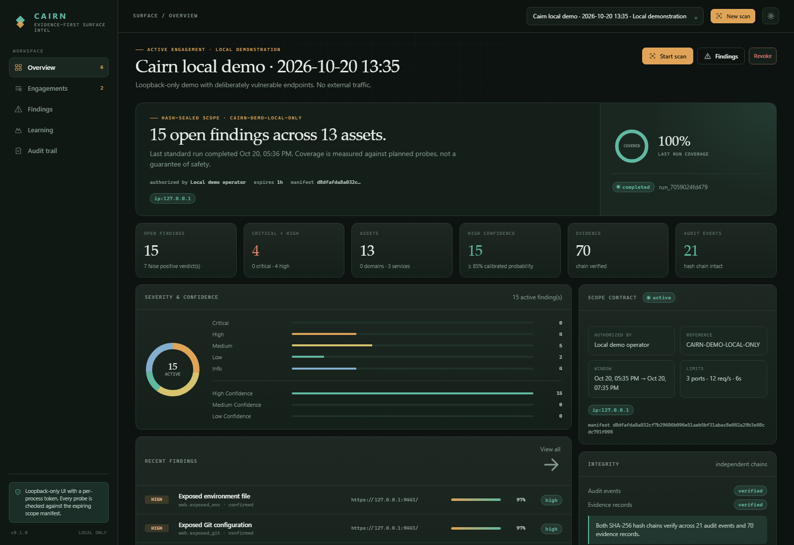
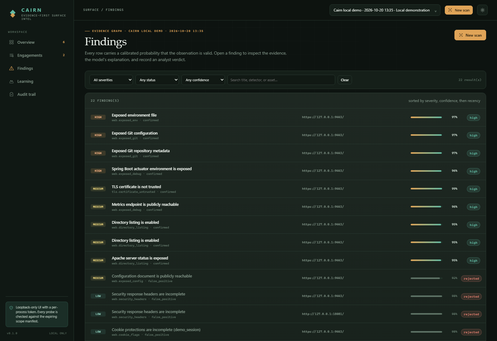
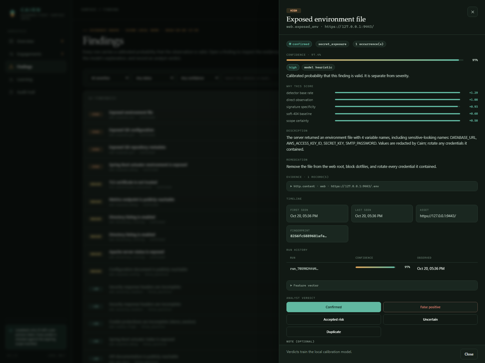
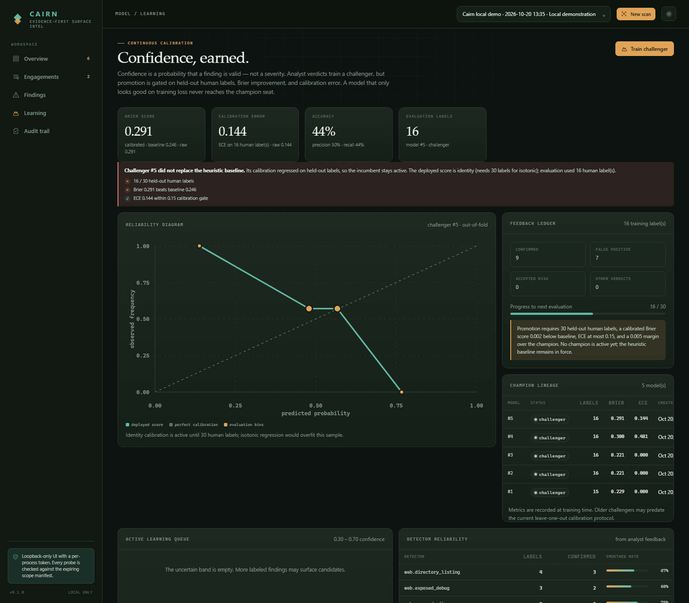

# Cairn

**Evidence-first attack surface intelligence for authorized assessments.**

Cairn is an end-to-end reconnaissance and enumeration workspace. It discovers
assets, captures verifiable evidence, scores every observation with a calibrated
probability, and gets measurably better as analysts review its work. It is not a
wrapper around an existing scanner, and it never crosses the line from
observation into exploitation.

```text
scope manifest ──▶ DNS / CT / RDAP ──▶ TCP + TLS ──▶ HTTP discovery
                                                         │
                    hash-chained evidence ◀──────────────┘
                              │
                    calibrated findings ──▶ analyst verdicts
                              │                    │
                              └──── challenger training ◀──┘
```



## Why Cairn

Most recon tools leave you with a list. Cairn leaves you with an argument you can
defend:

- **A real authorization boundary.** Every target is attached to a hash-sealed,
  expiring scope manifest. The guard re-resolves DNS per connection, denies
  metadata and link-local addresses, requires explicit scope for private
  targets, and writes a decision to the audit chain.
- **Evidence, not vibes.** Findings reference stored evidence with SHA-256
  hash chains. The audit log is independently verifiable, and secrets are
  redacted before they reach the database.
- **Calibrated confidence.** A transparent logistic baseline gives way to a
  learned challenger only after enough held-out human labels, a Brier
  improvement, and an ECE quality gate. Small samples are reported honestly
  instead of being overfit.
- **Learning that can say no.** Analyst verdicts train challengers; weak labels
  are capped and excluded from evaluation; champions are replaced only when they
  win on held-out data. If calibration regresses, the dashboard says so.
- **A local-first cockpit.** A token-authenticated, loopback-only GUI with
  scope visualization, finding drawers, evidence inspection, calibration
  charts, and an active-learning queue. No telemetry, no cloud dependency.

## What it does

| Phase | Capability |
| --- | --- |
| Scope | Explicit include/exclude rules for domains, wildcard domains, IPs, CIDRs, and URL prefixes; expiring manifests; per-connection checks |
| Passive intel | Certificate Transparency search, RDAP registration data, DNS records, CNAME analysis |
| Discovery | Subdomain enumeration, TCP connect scan of top ports or an explicit list, TLS certificate/protocol capture |
| Web | Content-path discovery, soft-404 baselining, technology signatures, robots/sitemap/security.txt parsing |
| Detection | Exposed Git metadata, env files, backups, debug endpoints, directory listings, admin interfaces, API docs, permissive CORS, cookie flags, missing headers, server disclosure, certificate issues, sensitive ports, dangling CNAMEs |
| Evidence | Redacted excerpts, response metadata, SHA-256 content hashes, per-engagement evidence chain |
| Analysis | Feature-based confidence, calibration curve, detector reliability, coverage ledger, active-learning queue |
| Output | Interactive HTML dashboard, standalone HTML/Markdown/JSON reports, CLI tables |

Cairn is deliberately **non-exploitative**. It does not submit credentials,
brute-force logins, upload payloads, exploit vulnerabilities, or attempt to
bypass access controls. A finding means "this observation is likely valid," not
"this system is compromised."



### Inside a finding



Confidence is not a badge with no backing. Each finding carries its feature
contributions, evidence excerpts, run history, fingerprint, and analyst verdict
controls. False-positive verdicts stay visible but are marked as rejected, so an
old model score cannot masquerade as an active conclusion.

### Calibration, including the misses



The learning screen shows the champion or latest challenger, the reliability
diagram, the promotion gate checklist, model lineage, detector reliability, and
the active-learning queue. A challenger that fails the sample-size or Brier gate
is retained and displayed, not quietly deleted.

## Quickstart

Requirements: Python 3.11+ and a terminal. The core runtime uses only FastAPI,
httpx, and uvicorn.

```bash
git clone https://github.com/Yum-research/cairn.git
cd cairn

python -m venv .venv
# Windows
.venv\Scripts\activate
# macOS / Linux
source .venv/bin/activate

pip install -e ".[dev]"
```

Run the loopback-only demonstration. It starts a deliberately exposed local
HTTP/HTTPS lab, creates a two-hour engagement scoped to `127.0.0.1`, scans it,
and keeps the dashboard running:

```bash
cairn demo --serve
```

The terminal prints the dashboard URL and a local access token. The token is
injected into the GUI automatically; the API requires it in `X-Cairn-Token`.
The demo never contacts an external target. Its self-signed certificate is
generated locally under `.cairn/`.

### Your first authorized engagement

```bash
cairn engagement create \
  --name "Acme external surface" \
  --client "Acme" \
  --authorized-by "Security Director" \
  --auth-ref "AUTH-2026-042" \
  --domain example.com \
  --wildcard \
  --expires 24h \
  --ports 80,443,8080

cairn scan --engagement <engagement-id> --mode standard
cairn serve
```

Use `cairn engagement list` to find the ID. The CLI and GUI create the same
scope manifest; the GUI asks for explicit confirmation before it will create an
engagement.

Useful commands:

```bash
cairn findings list --engagement <id>
cairn finding show <finding-id>
cairn feedback <finding-id> --verdict confirmed --note "validated with owner"
cairn learn stats
cairn learn retrain
cairn report --run <run-id> --format html --out report.html
cairn audit verify --engagement <id>
cairn scope check --engagement <id> --host example.com --port 443
```

Pass `--json` to machine-readable commands where supported. The database lives
at `.cairn/cairn.db` by default; override it with `CAIRN_DB` or the global
`--db` option **before** the subcommand:

```bash
cairn --db ./assessments/acme.db findings list --engagement <id>
```

## The confidence model

Every finding carries a probability that the observation is valid, plus a
ranked explanation of the features that moved the score. The baseline is a
small, inspectable logistic model over nine features:

`prior_logit`, `direct`, `corroboration`, `independent`, `specificity`,
`soft404_clear`, `coverage`, `freshness`, `scope_certainty`.

The learning loop is intentionally conservative:

1. Analyst verdicts are stored with the finding's feature vector.
2. A challenger is trained with weighted L2 logistic regression and evaluated
   with 5-fold out-of-fold predictions.
3. Below 30 human labels, calibration stays at identity to avoid overfitting an
   isotonic curve to noise. Above that threshold, isotonic calibration is fit
   and evaluated leave-one-out.
4. Promotion requires at least 30 held-out human labels, a calibrated Brier
   score below the base-rate baseline, ECE at or below 0.15, and a 0.005 margin
   over the current champion.
5. If no gate is met, the challenger is retained with its metrics and blockers,
   and the dashboard shows exactly why it did not win.

See [CONFIDENCE.md](CONFIDENCE.md) for the math and the failure modes this design
is trying to avoid.

## Safety model

Cairn is built for engagements where you can name the person who authorized the
work and the document that proves it.

- **Explicit manifest.** Name, client, authorizer, authorization reference,
  start/end timestamps, scope rules, ports, rate limits, and a manifest hash are
  stored before any target is touched.
- **Default deny.** Includes must be present; excludes win; every host, IP, URL,
  and port is checked at the connection boundary.
- **DNS rebinding resistance.** A domain grant authorizes public addresses, not
  a rebind into loopback, RFC1918 space, or cloud metadata. Private targets need
  explicit IP/CIDR scope. Metadata and link-local addresses are always denied.
- **Bounded effort.** Per-host rate limits, host ceilings, redirect limits, body
  caps, evidence caps, and an engagement window of at most 180 days.
- **Local API.** The server binds `127.0.0.1`, validates the `Host` header,
  requires a constant-time token check, sets a nonce-based CSP, and disables
  API docs and caching.
- **Redaction by default.** Authorization headers, cookies, keys, tokens,
  private keys, cloud credentials, and URL query secrets are redacted before
  storage.

Read [ETHICS.md](ETHICS.md) before using Cairn on anything you do not own or
have written permission to test. If you believe you found a vulnerability in
Cairn itself, see [SECURITY.md](SECURITY.md).

## Architecture at a glance

```text
cairn/
  api/           FastAPI app, security middleware, token-injected GUI
  engine/        orchestrator, web scanner, detectors, passive intel, recorder
  intel/         features, confidence, calibration, learning, adaptive policy
  net/           async DNS, safe HTTP, TCP scanner, TLS capture, rate limiting
  gui/           dependency-free single-page dashboard
  db.py          SQLite schema, repositories, hash chains
  scope.py       manifest validation and the scope guard
  reporting.py   standalone HTML, Markdown, JSON
  demo.py        loopback-only lab with HTTP and HTTPS listeners
tests/           scope, learning, ledger, API, redaction, and E2E tests
```

The full design is in [ARCHITECTURE.md](ARCHITECTURE.md).

## Development

```bash
pip install -e ".[dev]"
ruff check .
pytest
```

The test suite includes a real loopback HTTP fixture and runs a complete scan
through the orchestrator. It verifies scope denial, metadata blocking, redaction,
hash-chain tamper detection, API authentication/Host checks, calibration gates,
and report generation.

The GUI is plain HTML/CSS/JavaScript with no build step. `node --check
cairn/gui/app.js` catches syntax errors; the API serves the assets directly.

## Limits

- Cairn is an observation tool, not an exploitation framework or a compliance
  certificate.
- Confidence is the probability that an observation is valid. It is not a
  severity score and does not prove exploitability.
- Passive intelligence depends on third-party sources (crt.sh, RDAP) and their
  availability; use `--no-online-intel` for an offline run.
- Web coverage is catalog-driven. The content-path catalog is intentionally
  broad but not exhaustive.
- Learned confidence requires human verdicts. The tool will not manufacture a
  champion from unlabeled data, and it will refuse to promote a model that only
  wins on training loss.

## License

Apache-2.0. See [LICENSE](LICENSE).

Cairn is intended for authorized security assessments, defensive validation,
research on systems you control, and education. You are responsible for the
scope you declare and the traffic you generate.
